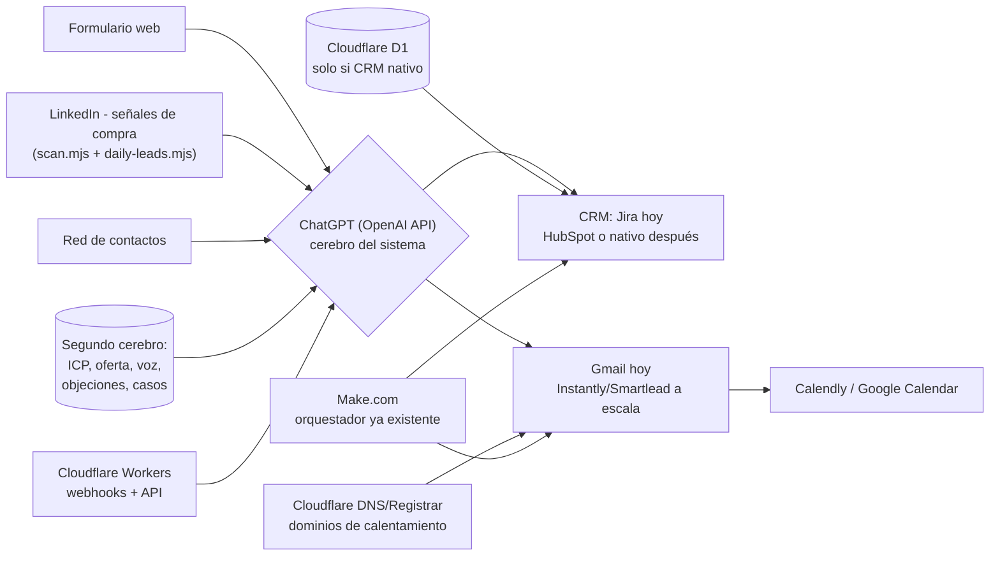

# Sistema de venta con agentes de IA — Santiso Marketing

Este documento traduce el booklet del taller **"Vender con Agentes de IA" (Cowork with AI)**
a un sistema concreto para Santiso Marketing, usando lo que **ya existe en este repo** más
las 3 piezas que fijamos: **Cloudflare** como infraestructura, **HubSpot o un CRM nativo**
(en desarrollo) como base de datos de clientes, y **ChatGPT** como cerebro.

No es teoría: cada pieza de abajo dice si ya está construida (y dónde) o si falta.

---

## 0. Dónde estamos vs. dónde vamos

| Estrategia (del taller) | Estado hoy en este repo | Qué falta para cerrar el ciclo |
|---|---|---|
| ① Inbound (te buscan) | ❌ No existe | Formulario → calificación → agenda |
| ② Outbound / señales de compra | 🟡 Lo más maduro: `scan.mjs` + `daily-leads.mjs` + `jira-lead-templates.mjs` | Enriquecer contacto, calificar con IA, redactar y enviar, sincronizar con el CRM final |
| ③ Referidos | ❌ No existe | Todo el flujo |
| ④ Contenido | 🟡 Muy desarrollado pero para clientes (Make.com), no para vender los servicios propios | Grabar/transcribir llamadas propias, generar `objeciones.md` / `casos-de-exito.md` solos |
| 🗂️ CRM | 🟡 Jira como pipeline improvisado (`SM-...`, etiquetas `lead-*`) | Decidir HubSpot vs. nativo y migrar |

---

## 1. Las 3 piezas que fijamos

### 🧠 Cerebro: ChatGPT
El taller deja elegir entre Claude, ChatGPT o Gemini. Se fija **ChatGPT**. Importante no
confundir dos productos distintos de OpenAI:

- **ChatGPT (Plus/Team, ~20-30 $/usuario/mes):** interfaz de chat para uso humano (redactar,
  pensar, revisar). Útil para ti, no la usa el sistema automatizado.
- **OpenAI API (pay-as-you-go, factura por tokens):** lo que realmente necesitan los agentes
  —Workers de Cloudflare, escenarios de Make.com o scripts de este repo— para calificar leads,
  redactar correos o resumir llamadas sin intervención humana.

Para este sistema, lo que hay que dar de alta es una **clave de API de OpenAI**, no (solo) un
asiento de ChatGPT. Modelo recomendado: uno económico (familia mini/flash-equivalente) para
tareas de alto volumen (calificar, clasificar) y uno más capaz para redacción final (correos,
mensajes de referidos).

### 🗂️ CRM: HubSpot o nativo (Cloudflare)
Las dos opciones siguen abiertas; para no bloquear el sistema mientras se decide, el diseño
de abajo trata el "CRM" como una pieza intercambiable (un solo punto donde se escribe el
lead con su etapa) y usa **Jira como interino**, porque ya funciona (`jira-lead-templates.mjs`).

| | HubSpot | Nativo (Cloudflare Workers + D1) |
|---|---|---|
| Tiempo a producción | Rápido (días) | Depende del desarrollo propio |
| Costo | Por asiento/plan, sube con Sales Hub Pro | Sin licencia; el costo es el tiempo de desarrollo + Cloudflare (barato) |
| Encaja con tu pipeline actual (Contactado→Respondió→Reunión→Presupuesto→Ganado/Perdido) | Hay que remapear a los "deal stages" de HubSpot | Se diseña calcado a lo que ya usas en Jira |
| Estado en esta cuenta | **Ya hay un conector de HubSpot preparado en Claude, solo falta autorizarlo** (claude.ai → Configuración → Conectores) | No tengo visibilidad del proyecto nativo desde este repo — si vive en otro repositorio, dímelo y lo conecto a esta sesión para integrarlo aquí |

Recomendación práctica: si el CRM nativo aún no tiene fecha firme, autoriza el conector de
HubSpot (ya está a medio camino) y úsalo en paralelo a Jira durante la transición; así no
esperas al desarrollo propio para empezar a vender con el sistema.

### ☁️ Cloudflare: para qué sirve exactamente aquí
Ya lo usan (DNS/hosting de webs de clientes). Para el sistema de venta, sus roles concretos son:

1. **Dominios secundarios "de calentamiento" para outbound** — el taller exige 3-5 dominios
   secundarios calentados antes de mandar correo masivo (página 2, checklist Semana 1).
   Cloudflare Registrar + DNS es donde se compran y configuran esos dominios (SPF, DKIM, DMARC).
2. **Cloudflare Email Routing** (gratis) — para recibir respuestas o notificaciones de leads
   sin depender de una bandeja más.
3. **Cloudflare Turnstile** — anti-spam en el formulario de la web para el flujo Inbound.
4. **Workers + D1 + Pages** — **solo si** se construye el CRM nativo: Workers como API,
   D1 como base de datos de leads/deals, Pages para el panel. No dupliques con esto lo que
   Make.com ya hace bien (ver nota siguiente).

> **No reemplaces Make.com.** Ya tienen ~200 escenarios funcionando (Sheets, Drive, Shopify,
> redes sociales, Jira, facturación...). Cloudflare debe cubrir lo que Make no resuelve bien
> (un CRM propio con UI, DNS de dominios de calentamiento, webhooks de baja latencia), no
> volver a construir la orquestación que ya existe.

---

## 2. Arquitectura

---

## 3. Los 4 flujos, con lo que ya existe marcado

### ① Inbound — te buscan a ti
**Estado: no construido.**

1. Formulario web (Typeform/Tally/WordPress) → 🔧 falta conectar
2. Enriquecer contacto → Apollo → 🔧 falta
3. Calificar contra `contexto/cliente-ideal.md` con ChatGPT → 🔧 falta
4. Correo personalizado con `contexto/voz.md` → 🔧 falta
5. Agenda automática (Calendly) → 🔧 falta
6. Registro en CRM → 🔧 falta (depende de la decisión HubSpot/nativo)

### ② Outbound / señales de compra — tú los buscas
**Estado: el más avanzado.** Ya construido en este repo:

- ✅ `scan.mjs` + `signals.mjs` — detectan intención de compra en LinkedIn (scroll en vivo o
  sobre HTML guardado), con scoring por palabras clave, cero coste de herramienta.
- ✅ `daily-leads.mjs` — barrido diario automático (Routine a las 17:00 España) que manda por
  Gmail los posts frescos con intención de compra (ver `DAILY_LEADS.md`).
- ✅ `jira-lead-templates.mjs` — convierte cada lead en una tarea de Jira con las secciones del
  taller (Oportunidad, Fuente, Contacto, Encaje, Cualificar, Próxima acción) y el pipeline
  Contactado → Respondió → Reunión → Presupuesto → Ganado/Perdido (ver `JIRA_TEMPLATES.md`).

Falta para cerrar el ciclo:

- 🔧 Enriquecimiento automático de correo/teléfono (hoy manual) → Apollo o FullEnrich.
- 🔧 Calificación por IA contra `contexto/cliente-ideal.md` (hoy solo scoring por palabras clave).
- 🔧 Redacción y envío del primer correo con ChatGPT + `contexto/voz.md`.
- 🔧 Activar el Epic "🎯 Leads / Prospección" en Jira (paso pendiente ya anotado en `JIRA_TEMPLATES.md`) o apuntar directamente al CRM final.

### ③ Referidos — te los presentan
**Estado: no construido.** Es el más barato de montar (no requiere herramientas nuevas, solo
LinkedIn + Gmail + ChatGPT, todo ya conectado):

1. Mapear red (LinkedIn) vs. `contexto/cliente-ideal.md` → 🔧 falta
2. Sugerencia semanal de 3 presentaciones (lunes) → 🔧 falta (podría ser un Routine, igual que `daily-leads.mjs`)
3. Mensaje listo para reenviar, con `contexto/voz.md` → 🔧 falta
4. Registro en CRM con "fuente: aliado" → 🔧 falta

### ④ Contenido — el combustible
**Estado: muy desarrollado, pero apuntando a otro objetivo.** Ya tienen decenas de escenarios
Make.com para publicar contenido de **clientes** (Instagram, LinkedIn, Google Business Profile,
YouTube...). Lo que pide el taller es distinto: convertir las llamadas de venta **propias** de
Santiso Marketing en combustible (objeciones nuevas, casos de éxito, posts).

Falta: 🔧 grabar/transcribir llamadas propias (Granola u otro), 🔧 resumen semanal por IA,
🔧 estas dos líneas quedan listas para automatizarse en cuanto exista la transcripción:
alimentar `contexto/objeciones.md` y `contexto/casos-de-exito.md` solas.

---

## 4. El "segundo cerebro" — documentos que faltan

El taller es claro: sin esto, el agente no vende como tú, vende genérico. Cree la carpeta
[`contexto/`](./contexto) con las 5 plantillas del taller (página 2, workbook). Ya dejé
pre-rellenado lo que se puede confirmar directamente desde este repo (líneas de servicio de
`JIRA_TEMPLATES.md`, marcas ya gestionadas vía Make.com); el resto queda marcado ☐ para que lo
completes a mano, tal como pide el taller:

- [`contexto/cliente-ideal.md`](./contexto/cliente-ideal.md)
- [`contexto/oferta.md`](./contexto/oferta.md)
- [`contexto/voz.md`](./contexto/voz.md)
- [`contexto/objeciones.md`](./contexto/objeciones.md)
- [`contexto/casos-de-exito.md`](./contexto/casos-de-exito.md)

Estos son los mismos ficheros que las SOPs del taller citan por nombre (`cliente-ideal.md`,
`voz.md`, `objeciones.md`, `casos-de-exito.md`) — cuando estén rellenos, cualquier prompt tipo
*"Sigue este SOP paso a paso para calificar este lead"* ya tiene de dónde leer tu voz real.

---

## 5. Lista de software por función

Qué ya tienen (verificado en esta cuenta/repo), qué añadir dado el stack fijado
(Cloudflare + ChatGPT + HubSpot/nativo), y alternativas del taller.

| Función | Ya lo tienes | Añadir con tu stack actual | Alternativas del taller |
|---|---|---|---|
| 🧠 Cerebro (LLM) | — | **OpenAI API** (clave de API, no solo el chat) | Claude API, Gemini |
| 🔍 Buscador de clientes | Scanner propio de LinkedIn (`scan.mjs`, gratis, solo señales) | **Apollo.io** (plan Basic/Professional) — cubre esto y el siguiente punto a la vez | Amplemarket, Clay |
| 📧 Buscador de correos/teléfono | — | Apollo (incluido); **FullEnrich** solo para los que Apollo no resuelva (cobra por dato encontrado) | Clay |
| ✉️ Envío masivo seguro | Gmail (conector ya activo, 1 cuenta — válido hasta ~30-50 correos/día) | **Instantly.ai** o **Smartlead** cuando el volumen outbound crezca (multi-dominio, warmup) | Lemlist |
| 🔗 LinkedIn automatizado (envío) | Solo lectura hoy (`scan.mjs` no escribe) | **SalesRobot** (1 cuenta) cuando quieran automatizar invitaciones/mensajes, no solo detectarlos | HeyReach (5+ cuentas) |
| 📡 Señales de compra | ✅ `scan.mjs` + `signals.mjs` (gratis, palabras clave) | Mantenerlo; evaluar **Trigify** solo si necesitan más fuentes que LinkedIn | Gojiberry AI, RB2B |
| 📞 Asistente de voz | — | **Vapi** o **Retell** (pay-per-uso, se integran bien vía Cloudflare Workers) — solo cuando el volumen de reuniones lo justifique | GoTo, NLPearl, ElevenLabs |
| 🗂️ CRM | Jira como pipeline interino (`jira-lead-templates.mjs`) | **Autorizar el conector de HubSpot ya presente** en esta cuenta, o seguir invirtiendo en el CRM nativo (Cloudflare Workers + D1) | Pipedrive, Attio |
| 🎙️ Voz → texto | Google Calendar/Drive conectados, sin transcripción | **Granola** — dobla como grabadora de llamadas propias, alimenta el SOP de Contenido | Wispr Flow, Otter |
| ☁️ Infraestructura/orquestación | **Make.com** (~200 escenarios activos), **Cloudflare** (DNS/hosting de clientes), GitHub | Ampliar uso de Cloudflare: Registrar/DNS para dominios de calentamiento, Email Routing, Turnstile; Workers+D1 solo si CRM nativo | Zapier, n8n |

> Los precios cambian con frecuencia — valida el actual antes de comprar. Los rangos del
> taller sirven de referencia de orden de magnitud, no de cotización.

---

## 6. Roadmap por nivel de inversión (marco del taller, aplicado a lo que falta)

**Nivel Inicial (~300 $/mes) — validar, con lo que ya tienen sumando 2 altas:**
1. Clave de **OpenAI API** — el cerebro.
2. **Apollo.io** (plan básico) — cubre buscador de clientes + correos.
3. Seguir usando Gmail para envío y Jira como CRM interino (ya pagados).
4. Cloudflare: dar de alta 3-5 dominios secundarios (Registrar) y configurar Email Routing (gratis).
5. Rellenar `contexto/*.md` — sin esto, ninguna compra de arriba rinde.

**Nivel Crecimiento (~1.500 $/mes) — cuando el volumen supere lo manual:**
6. **Instantly.ai** o **Smartlead** para envío multi-dominio.
7. Decidir CRM: autorizar **HubSpot** (conector ya listo) o dar prioridad al desarrollo del nativo.
8. **Granola** para transcripción de llamadas → activa el SOP de Contenido.

**Nivel Avanzado (~5.000+ $/mes) — con reuniones agendadas de sobra:**
9. **SalesRobot/HeyReach** para LinkedIn a escala.
10. **Vapi/Retell** para confirmación de reuniones por voz.
11. **Trigify/RB2B** si necesitan más señales de compra que las de LinkedIn.

Regla del taller: si con **una venta al mes** pagas el nivel en el que estás, vas bien.

---

## 7. Próximos pasos concretos

- [ ] Rellenar `contexto/cliente-ideal.md`, `oferta.md`, `voz.md`, `objeciones.md`, `casos-de-exito.md`
- [ ] Decidir HubSpot (autorizar conector) vs. seguir con el CRM nativo — o ambos en paralelo
- [ ] Dar de alta la clave de OpenAI API
- [ ] Activar el Epic "🎯 Leads / Prospección" en Jira (pendiente en `JIRA_TEMPLATES.md`)
- [ ] Comprar Apollo.io y conectar el enriquecimiento a `daily-leads.mjs` / `jira-lead-templates.mjs`
- [ ] Registrar 3-5 dominios secundarios en Cloudflare y empezar el calentamiento
- [ ] Si el CRM nativo vive en otro repositorio, decírmelo para conectarlo a esta sesión y diseñar la integración real (Workers/D1/API)
